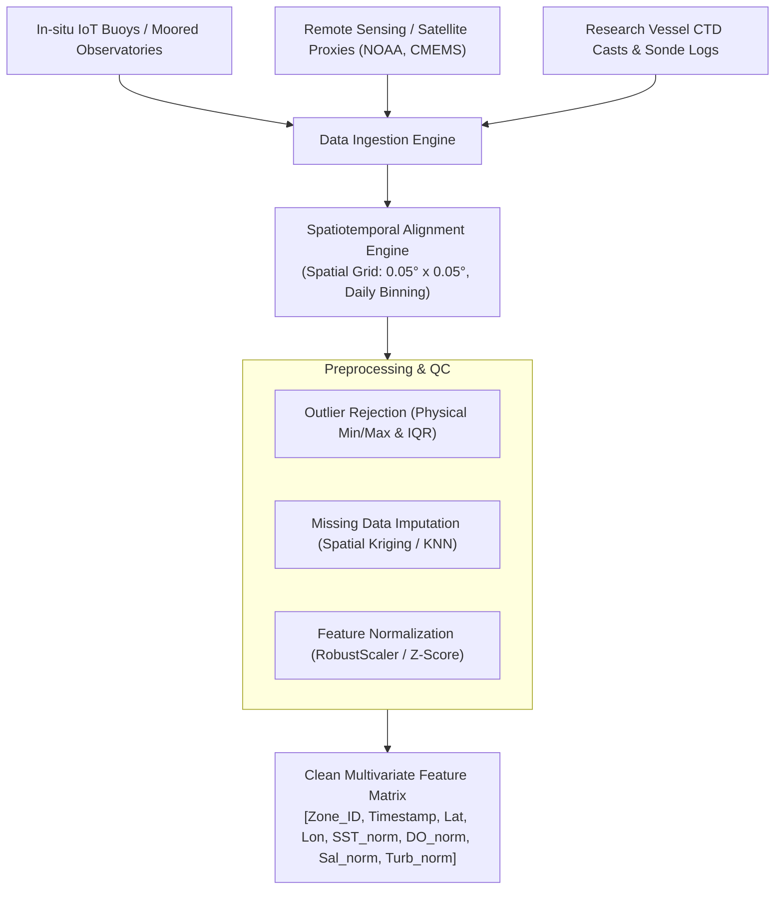
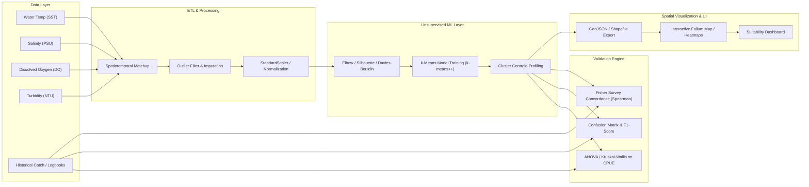

# K-Means Clustering of Coastal Water-Quality Sensor Data for Fishing-Zone Suitability Mapping
## Comprehensive Research, Methodology, and Validation Framework

---

### Executive Summary

Marine fisheries represent a vital pillar of global food security, coastal livelihoods, and maritime economics. However, traditional fishing practices often rely on trial-and-error, inherited heuristics, or broad-brush regional forecasts, leading to excessive fuel consumption, increased operational expenditures (OPEX), and elevated carbon emissions. 

This project establishes a data-driven, machine learning framework to map **Potential Fishing Zone (PFZ)** suitability at high spatial and temporal resolution. By compiling multivariate coastal water-quality sensor streams—specifically **Salinity**, **Turbidity**, **Dissolved Oxygen (DO)**, and **Sea Surface Temperature (SST)**—and applying unsupervised **$k$-Means Clustering**, candidate maritime zones are segmented into distinct ecological suitability regimes. These clusters are rigorously validated against empirical fisheries records: **Catch Per Unit Effort (CPUE)** and qualitative **fisher-reported zone productivity logs**.

---

## 1. Domain Foundations: Oceanography & Marine Biology

Fish species are poikilothermic (cold-blooded) organisms whose metabolic rates, feeding aggregations, reproductive triggers, and spatial distributions are constrained by oceanographic physicochemical boundaries.

```
                    +-----------------------------------------+
                    |    Multivariate Physicochemical Mesh    |
                    +-----------------------------------------+
                         /         |            |         \
                        /          |            |          \
                       v           v            v           v
               +-------------+ +-------+ +------------+ +-----------+
               | Temperature | |   DO  | |  Salinity  | | Turbidity |
               +-------------+ +-------+ +------------+ +-----------+
                      |            |            |             |
                      +------------+------------+-------------+
                                         |
                                         v
                         +-------------------------------+
                         | Primary Productivity / Plankton |
                         |   & Osmoregulatory Habitat    |
                         +-------------------------------+
                                         |
                                         v
                         +-------------------------------+
                         | Pelagic Fish School Aggregation|
                         +-------------------------------+
```

### Parameter Breakdown & Ecological Sensitivity

| Parameter | Unit | Target / Favorable Range | Biological & Oceanographic Impact | Risk / Anomalous Conditions |
| :--- | :--- | :--- | :--- | :--- |
| **Dissolved Oxygen (DO)** | $\text{mg/L}$ or $\text{ppm}$ | $5.0 - 8.5\ \text{mg/L}$ | Essential for cellular respiration and swimming performance. Highly active pelagic teleosts (e.g., mackerel, tuna, sardines) require high ambient DO. | Hypoxia ($<2.0 - 3.0\ \text{mg/L}$) triggers rapid fish evasion or mortalities ("dead zones"). Super-saturation ($>110\%$) can cause gas bubble trauma. |
| **Sea Surface Temperature (SST)** | ${}^\circ\text{C}$ | Species-dependent ($24 - 29{}^\circ\text{C}$ for tropical/subtropical) | Regulates basal metabolic rate, enzyme kinetics, and dissolved gas solubility. Ocean thermal fronts (eddies, upwelling boundaries) trap nutrients and forage fish. | Thermal shock ($>31{}^\circ\text{C}$ or sharp localized drops) induces thermal stress, suppresses spawning, and degrades dissolved oxygen holding capacity. |
| **Salinity** | $\text{PSU}$ (or $\text{g/kg}$) | $32.0 - 35.5\ \text{PSU}$ (marine); $15 - 28\ \text{PSU}$ (estuarine) | Dictates osmoregulatory balance and cellular hydration. Marine fish drink seawater and excrete salt ions; large gradient shifts demand high energetic expenditure. | Heavy freshwater plumes ($<20\ \text{PSU}$ in open marine zones) cause osmoregulatory collapse in stenohaline pelagic species. |
| **Turbidity** | $\text{NTU}$ or $\text{FNU}$ | $1.0 - 15.0\ \text{NTU}$ | Turbidity represents optical water clarity. Moderate turbidity driven by biological matter (phytoplankton, zooplankton) signals rich foraging grounds. | High inorganic turbidity ($>30 - 50\ \text{NTU}$) from river runoff, dredging, or storm silt clogs gills, limits visual foraging, and impedes primary photic penetration. |

---

## 2. Objective 1: Sensor Data Compilation & Pipeline Architecture

Objective 1 centers on acquiring, synchronizing, cleaning, and standardizing heterogeneous sensor observations across candidate geographic coordinates.



### 2.1 Candidate Data Ingestion Sources
1. **In-situ Marine Sensor Buoys / Coastal Observatories:**
   - Moored buoys equipped with multiparameter sondes (e.g., YSI EXO, Seabird CTD, Aanderaa optodes).
   - Data attributes: timestamp, latitude, longitude, depth (standardized to surface $0.5 - 2.0\ \text{m}$), temperature, conductivity/salinity, optical turbidity, optical DO.
   - Public open data portals: NOAA National Data Buoy Center (NDBC), Copernicus Marine Service (CMEMS In-situ TAC), Indian National Centre for Ocean Information Services (INCOIS), or regional coastal pollution boards.
2. **Satellite Earth Observation (SEO) Proxies:**
   - Sea Surface Temperature (SST) via MODIS-Aqua, VIIRS, or AVHRR.
   - Turbidity / Chlorophyll-a via Sentinel-3 OLCI or NASA Ocean Color ($K_d(490)$ diffuse attenuation coefficient as a turbidity proxy).
   - Sea Surface Salinity (SSS) via SMAP/SMOS.

### 2.2 Preprocessing & Feature Engineering Pipeline
Sensor data in marine environments suffers from biofouling, sensor drift, transmission dropout, and weather interference.

1. **Range & Boundary Filtering:**
   Eliminate physical impossibilities prior to statistical filtering:
   $$\text{DO} \in [0.0, 15.0]\ \text{mg/L}, \quad \text{SST} \in [5.0, 38.0]^\circ\text{C}, \quad \text{Salinity} \in [0.0, 42.0]\ \text{PSU}, \quad \text{Turbidity} \in [0.0, 300.0]\ \text{NTU}$$

2. **Outlier Filtering (IQR / Isolation Forest):**
   For rolling spatial windows, drop or flag spikes exceeding:
   $$[Q_1 - 1.5 \times \text{IQR},\ Q_3 + 1.5 \times \text{IQR}]$$

3. **Spatiotemporal Binning & Interpolation:**
   - Spatial discretization into a regular spatial grid (e.g., $0.05^\circ \times 0.05^\circ \approx 5.5\ \text{km} \times 5.5\ \text{km}$).
   - Temporal aggregation into diurnal/daily median metrics to eliminate high-frequency tidal or daylight solar-heating artifacts.
   - For missing spatial points, apply **$K$-Nearest Neighbors (KNN) Spatial Imputation** or **Inverse Distance Weighting (IDW)**.

4. **Feature Standardization:**
   Because $k$-Means relies on Euclidean distance, variables with naturally higher variance or larger numerical magnitudes will dominate the objective function if unscaled:
   - *StandardScaler (Z-score):*
     $$z = \frac{x - \mu}{\sigma}$$
   - *RobustScaler (Preferred if extreme oceanic events/storms exist in data):*
     $$x_{\text{scaled}} = \frac{x - Q_2}{Q_3 - Q_1}$$

---

## 3. Objective 2: $k$-Means Clustering for Suitability Segmentation

Objective 2 partitions the $N \times 4$ normalized feature space into $K$ non-overlapping clusters corresponding to environmental suitability states.

### 3.1 Mathematical Formulation of $k$-Means
Given an input dataset $\mathbf{X} = \{\mathbf{x}_1, \mathbf{x}_2, \dots, \mathbf{x}_n\}$, where each sample vector is:
$$\mathbf{x}_i = [\tilde{T}_i, \tilde{DO}_i, \tilde{S}_i, \tilde{\tau}_i]^T \in \mathbb{R}^4$$

$k$-Means assigns the $n$ samples into $K$ disjoint sets $S = \{S_1, S_2, \dots, S_K\}$ to minimize the within-cluster sum of squares (WCSS / Inertia):
$$J = \sum_{j=1}^{K} \sum_{\mathbf{x}_i \in S_j} \|\mathbf{x}_i - \boldsymbol{\mu}_j\|_2^2$$
where $\boldsymbol{\mu}_j = \frac{1}{|S_j|} \sum_{\mathbf{x}_i \in S_j} \mathbf{x}_i$ is the centroid of cluster $S_j$.

### 3.2 Determining the Optimal Number of Clusters ($K$)
To avoid arbitrary selection of $K$, employ a tri-factor consensus heuristic:

```
      Inertia (Elbow)               Silhouette Coefficient             Davies-Bouldin Index
    (Minimize WCSS bend)          (Maximize Cohesion/Separation)       (Minimize Cluster Ratio)
          \                               |                              /
           \                              |                             /
            +-----------------------------+----------------------------+
                                          |
                                          v
                      [ Consensus Optimal K Selection (e.g., K = 3 to 5) ]
```

1. **Elbow Method:** Compute Inertia $J(K)$ for $K \in [2, 10]$. Locate the inflection point using the second derivative / maximum curvature metric.
2. **Silhouette Analysis:** Evaluate average silhouette width:
   $$s(i) = \frac{b(i) - a(i)}{\max(a(i), b(i))}, \quad s(i) \in [-1, 1]$$
   where $a(i)$ is the mean intra-cluster distance and $b(i)$ is the mean nearest-cluster distance. Optimal $K$ maximizes $\bar{s}$.
3. **Davies-Bouldin (DB) Index:**
   $$R_{ij} = \frac{s_i + s_j}{d(\boldsymbol{\mu}_i, \boldsymbol{\mu}_j)}, \quad DB = \frac{1}{K}\sum_{i=1}^K \max_{j \neq i} R_{ij}$$
   Lower values indicate better separation and higher intra-cluster compactness.

### 3.3 Semantic Cluster Profiling (Suitability Mapping)
Once the algorithm converges, reverse-transform the cluster centroids $\boldsymbol{\mu}_j$ back to physical units and rank them according to marine biological suitability criteria:

| Cluster Label | Projected Centroid Characteristics | Oceanographic Phenomenon | Suitability Classification | Operational Advisory |
| :--- | :--- | :--- | :--- | :--- |
| **Cluster A** | High DO ($>6.5\ \text{mg/L}$), Optimal SST ($26-28^\circ\text{C}$), Marine Salinity ($34\ \text{PSU}$), Moderate Turbidity ($5-12\ \text{NTU}$) | Productive Upwelling Front / Phytoplankton Bloom | **Highly Suitable (Prime PFZ)** | Primary fishing operations targeted here. Expect high pelagic schools. |
| **Cluster B** | Moderate DO ($4.5-5.5\ \text{mg/L}$), Moderate SST ($28-30^\circ\text{C}$), Marine Salinity ($33\ \text{PSU}$), Low Turbidity ($1-4\ \text{NTU}$) | Clear Oligotrophic Open Coastal Water | **Moderate / Marginal Suitability** | Dispersed schools; secondary fishing ground. |
| **Cluster C** | High Turbidity ($>35\ \text{NTU}$), Fluctuating/Low Salinity ($<25\ \text{PSU}$), High SST ($>30.5^\circ\text{C}$) | Estuarine / Riverine Sediment Discharge Plume | **Unsuitable / River Discharge** | Poor gill filtration; low pelagic catch; danger of gear snagging. |
| **Cluster D** | Depressed DO ($<3.0\ \text{mg/L}$), High SST ($>31^\circ\text{C}$), Normal Salinity | Hypoxic / Stagnant Coastal Inversion | **Unfavorable / Stress Zone** | Biological avoidance; near-zero pelagic catch. Avoid zone. |

---

## 4. Objective 3: Validation Framework Against Catch Records

Clustering is unsupervised; validation requires corroboration against ground-truth fisheries performance indicators. Objective 3 bridges statistical clustering with fisheries biology.

```
+------------------------------------+       +------------------------------------+
|    Predicted Spatial Clusters      |       |      Empirical Fisheries Data      |
| [Cluster A, Cluster B, Cluster C]  |       |   [Daily CPUE, Logbooks, Survey]   |
+------------------------------------+       +------------------------------------+
                  \                                     /
                   \                                   /
                    v                                 v
        +-------------------------------------------------------------+
        |            Spatiotemporal Matchup & Alignment               |
        |   (Merge by Zone ID / Nearest GPS Coord & Fishing Date)     |
        +-------------------------------------------------------------+
                                       |
                 +---------------------+---------------------+
                 |                                           |
                 v                                           v
     +-----------------------+                   +-----------------------+
     | Quantitative Catch    |                   | Qualitative Fisher    |
     | Analysis (CPUE)       |                   | Surveys & Logbooks    |
     +-----------------------+                   +-----------------------+
     | - One-Way ANOVA       |                   | - Spearman Rank Corr  |
     | - Tukey's HSD Test    |                   | - Confusion Matrix    |
     | - Cohen's d Effect    |                   | - Precision, Recall,  |
     | - Boxplot Distributions|                  |   F1-Score, ROC-AUC   |
     +-----------------------+                   +-----------------------+
```

### 4.1 Ground-Truth Metric Definitions

1. **Catch Per Unit Effort (CPUE):**
   Standardized measure of fish abundance:
   $$\text{CPUE} = \frac{\text{Total Landed Catch Biomass } (\text{kg})}{\text{Fishing Effort}}$$
   Where fishing effort is parameterized by gear type:
   - *Trawl / Purse Seine:* Hours of active towing / setting ($\text{kg/hour}$).
   - *Longline / Gillnet:* Number of hooks or net panel length $\times$ soaking time ($\text{kg/1000 hooks}\cdot\text{hr}$).
   - *Fuel-normalized index:* $\text{kg of catch / liter of diesel consumed}$.

2. **Fisher-Reported Productivity Records (TEK / Logbooks):**
   - Qualitative ranking: Likert scale $1$ (Barren/Poor) to $5$ (Exceptional harvest).
   - Commercial catch threshold: Binary ground truth $Y \in \{0, 1\}$ where $Y=1$ if $\text{CPUE} \ge 75^{\text{th}}\ \text{percentile}$.

### 4.2 Statistical Validation Methodology

#### A. Parametric & Non-Parametric Hypothesis Testing
To validate that suitability clusters exhibit statistically significant differences in actual fish yields:
- **Null Hypothesis ($H_0$):** $\mu_{\text{CPUE}}(\text{Cluster A}) = \mu_{\text{CPUE}}(\text{Cluster B}) = \dots = \mu_{\text{CPUE}}(\text{Cluster K})$
- **Alternative Hypothesis ($H_1$):** At least one cluster has a significantly different mean CPUE.

1. **One-Way ANOVA (if normality and homoscedasticity hold via Shapiro-Wilk & Levene tests):**
   $$F = \frac{\text{MS}_{\text{between}}}{\text{MS}_{\text{within}}}$$
2. **Kruskal-Wallis $H$-Test (if non-normal / skewed catch data):**
   $$H = \frac{12}{N(N+1)} \sum_{j=1}^K \frac{R_j^2}{n_j} - 3(N+1)$$
3. **Post-Hoc Pairwise Tests (Tukey's HSD or Dunn's Test with Bonferroni correction):**
   Validates whether $\text{CPUE}(\text{Cluster A}) > \text{CPUE}(\text{Cluster B})$ at significance level $\alpha = 0.01$.

#### B. Classification & Information Retrieval Metrics
Transform the unsupervised clusters into a binary PFZ classifier by defining $\hat{Y} = 1$ if sample $\in \text{Cluster A (Optimal)}$:

| Metric | Formula | Interpretation in Fisheries Context |
| :--- | :--- | :--- |
| **Precision** | $\frac{TP}{TP + FP}$ | Fraction of recommended fishing zones that actually produced high catch. High precision minimizes wasted vessel fuel. |
| **Recall (Sensitivity)** | $\frac{TP}{TP + FN}$ | Fraction of all high-catch zones correctly identified by the water-quality clusters. High recall ensures fishermen do not miss productive schools. |
| **F1-Score** | $2 \cdot \frac{\text{Precision} \cdot \text{Recall}}{\text{Precision} + \text{Recall}}$ | Harmonic balance between avoidance of dry runs and capture of productive zones. |
| **ROC-AUC** | $\int_0^1 \text{TPR}(FPR^{-1}(t)) dt$ | Discriminative power across varying suitability distance thresholds. |

#### C. Concordance with Fisher Experience
Calculate **Spearman’s Rank Correlation ($\rho$)** between the cluster suitability index $(1 \dots K)$ and the qualitative fisher score $(1 \dots 5)$:
$$\rho = 1 - \frac{6 \sum d_i^2}{n(n^2 - 1)}$$
A significant positive correlation ($\rho > 0.65, p < 0.001$) confirms empirical alignment with traditional local ecological knowledge.

---

## 5. End-to-End System Architecture



---

## 6. Implementation Blueprint: Python Pipeline Code

Below is the modular Python architecture for executing the complete workflow:

```python
"""
Coastal Water Quality k-Means Fishing Zone Suitability Pipeline
Author: Semester 5 Machine Learning Team
"""

import numpy as np
import pandas as pd
from sklearn.preprocessing import StandardScaler, RobustScaler
from sklearn.cluster import KMeans
from sklearn.metrics import silhouette_score, davies_bouldin_score
import scipy.stats as stats
import folium

class CoastalWaterQualityPipeline:
    def __init__(self, n_clusters=3, random_state=42):
        self.n_clusters = n_clusters
        self.random_state = random_state
        self.features = ['temperature', 'salinity', 'dissolved_oxygen', 'turbidity']
        self.scaler = RobustScaler()
        self.kmeans = None

    def clean_and_preprocess(self, df: pd.DataFrame) -> pd.DataFrame:
        """Physical boundary filtering, missing imputation, and scaling."""
        df_clean = df.copy()
        
        # Physical boundary masks
        df_clean = df_clean[
            (df_clean['temperature'].between(10, 36)) &
            (df_clean['salinity'].between(10, 40)) &
            (df_clean['dissolved_oxygen'].between(0.5, 14.0)) &
            (df_clean['turbidity'].between(0.1, 200.0))
        ]
        
        # Missing value fill using temporal rolling median
        df_clean[self.features] = df_clean[self.features].fillna(df_clean[self.features].median())
        
        # Scale features
        self.scaled_features = self.scaler.fit_transform(df_clean[self.features])
        return df_clean

    def optimize_k(self, max_k=7):
        """Evaluate Elbow Inertia, Silhouette, and Davies-Bouldin metrics."""
        results = []
        for k in range(2, max_k + 1):
            km = KMeans(n_clusters=k, init='k-means++', n_init=15, random_state=self.random_state)
            labels = km.fit_predict(self.scaled_features)
            sil = silhouette_score(self.scaled_features, labels)
            db = davies_bouldin_score(self.scaled_features, labels)
            results.append({'k': k, 'inertia': km.inertia_, 'silhouette': sil, 'davies_bouldin': db})
        return pd.DataFrame(results)

    def fit_predict(self, df: pd.DataFrame) -> pd.DataFrame:
        """Fit k-means model and map clusters to suitability taxonomy."""
        self.kmeans = KMeans(
            n_clusters=self.n_clusters, 
            init='k-means++', 
            n_init=20, 
            random_state=self.random_state
        )
        df['cluster'] = self.kmeans.fit_predict(self.scaled_features)
        
        # Calculate centroids in original physical units
        centroids = pd.DataFrame(
            self.scaler.inverse_transform(self.kmeans.cluster_centers_), 
            columns=self.features
        )
        
        # Heuristic scoring: High DO, Moderate Turbidity, Optimal Temp (~27C)
        centroids['score'] = (
            centroids['dissolved_oxygen'] * 2.0 - 
            np.abs(centroids['temperature'] - 27.5) * 1.5 - 
            centroids['turbidity'] * 0.1
        )
        
        # Map cluster ID to Suitability Ranks
        rank_order = centroids['score'].sort_values(ascending=False).index
        suitability_map = {cluster_id: rank + 1 for rank, cluster_id in enumerate(rank_order)}
        label_map = {1: 'High Suitability (PFZ)', 2: 'Moderate Suitability', 3: 'Low / Unsuitable'}
        
        df['suitability_rank'] = df['cluster'].map(suitability_map)
        df['suitability_label'] = df['suitability_rank'].map(label_map)
        return df, centroids

    def validate_against_catch(self, df_with_catch: pd.DataFrame):
        """Statistical hypothesis testing (ANOVA / Kruskal-Wallis) on CPUE."""
        groups = [group['cpue'].values for _, group in df_with_catch.groupby('suitability_rank')]
        
        # Kruskal-Wallis test (robust to non-normal catch distributions)
        kw_stat, kw_p = stats.kruskal(*groups)
        
        # Summary statistics per cluster
        summary = df_with_catch.groupby('suitability_label')['cpue'].agg(
            ['count', 'mean', 'std', 'median']
        )
        return {'kruskal_statistic': kw_stat, 'p_value': kw_p, 'summary': summary}

    def generate_suitability_map(self, df: pd.DataFrame, output_html="coastal_pfz_map.html"):
        """Plot clustered candidate zones on an interactive Folium leaflet map."""
        center_lat = df['latitude'].mean()
        center_lon = df['longitude'].mean()
        m = folium.Map(location=[center_lat, center_lon], zoom_start=9, tiles="CartoDB positron")
        
        color_palette = {1: 'green', 2: 'orange', 3: 'red'}
        
        for _, row in df.iterrows():
            folium.CircleMarker(
                location=[row['latitude'], row['longitude']],
                radius=6,
                color=color_palette.get(row['suitability_rank'], 'gray'),
                fill=True,
                fill_opacity=0.7,
                popup=(f"Zone: {row.get('zone_id', 'N/A')}<br>"
                       f"Class: {row['suitability_label']}<br>"
                       f"DO: {row['dissolved_oxygen']:.2f} mg/L<br>"
                       f"Temp: {row['temperature']:.1f} °C<br>"
                       f"Salinity: {row['salinity']:.1f} PSU<br>"
                       f"Turbidity: {row['turbidity']:.1f} NTU")
            ).add_to(m)
            
        m.save(output_html)
        return output_html
```

---

## 7. Practical Considerations & Methodological Risks

| Risk / Challenge | Operational Manifestation | Mitigation Strategy |
| :--- | :--- | :--- |
| **Biofouling & Sensor Drift** | Optical DO and turbidity probes experience algal growth, leading to artificial upward drift in turbidity and downward drift in DO. | Apply temporal baseline drift correction; discard readings with rapid variance drops; use satellite attenuation coefficients for cross-check. |
| **Cloud Cover in Remote Sensing** | Optical satellite sensors (MODIS, Sentinel-3) cannot penetrate monsoon clouds, creating large observational holes. | Blend in-situ moored buoy feeds with microwave SST (AMSR2) which penetrates clouds, or apply spatio-temporal Kriging. |
| **Non-Spherical Clusters** | $k$-Means inherently assumes isotropic, spherical clusters of equal variance, which may not strictly reflect natural marine ecotones. | Compare baseline $k$-Means with Gaussian Mixture Models (GMM) or DBSCAN during preliminary model selection. |
| **Reporting Bias in Fisher Logs** | Fishermen may under-report catch yields in lucrative zones to protect commercial secrets, or misreport exact GPS coordinates. | Aggregate to anonymized spatial grid cells; cross-validate with satellite Vessel Monitoring System (VMS) or AIS tracking data. |
| **Time-Lag Between Water Quality & Fish Aggregation** | Primary productivity blooms (phytoplankton) take 24–72 hours to attract herbivorous baitfish, which subsequently attract pelagic predators. | Incorporate lagged features ($t-24\ \text{hr}$, $t-48\ \text{hr}$) into the multivariate vector to capture trophic succession. |

---

## 8. Academic Deliverables & Semester Roadmap

1. **Phase 1: Dataset Compilation & Exploration (Weeks 1–3)**
   - Curate coastal buoy sensor CSVs and catch-yield datasets (synthetic or real from INCOIS/NOAA/local fisheries).
   - Exploratory Data Analysis (EDA): Correlation matrices, pairplots, seasonal time-series decomposition.
2. **Phase 2: Preprocessing & $k$-Means Modeling (Weeks 4–6)**
   - Scaling pipeline (Robust vs. Standard).
   - Cluster optimization ($K=2 \dots 8$) via Inertia, Silhouette, and Davies-Bouldin.
   - Ecological centroid labeling and suitability index formulation.
3. **Phase 3: Validation & Statistical Testing (Weeks 7–9)**
   - Matchup merge with catch records.
   - ANOVA / Kruskal-Wallis hypothesis tests and boxplot visualizations.
   - Binary classification metrics (Precision, Recall, F1, ROC curve) against top-quartile yields.
4. **Phase 4: Geospatial Dashboard & Project Report (Weeks 10–12)**
   - Interactive Folium web map / Streamlit UI for fishing zone visualization.
   - Project report documentation, methodology diagrams, and presentation slides.

---

### Key References & Literature
- **Valavanis, V. D., et al.** (2008). *Critical regions: A review on novel methods for identifying essential fish habitats.* Aquatic Conservation: Marine and Freshwater Ecosystems.
- **Solanki, H. U., et al.** (2005). *Application of remote sensing in Potential Fishing Zones (PFZ) forecast and validation along the Indian coast.* Indian Journal of Marine Sciences.
- **MacQueen, J.** (1967). *Some methods for classification and analysis of multivariate observations.* 5th Berkeley Symposium on Mathematical Statistics and Probability.
- **Rousseeuw, P. J.** (1987). *Silhouettes: a graphical aid to the interpretation and validation of cluster analysis.* Journal of Computational and Applied Mathematics.
- **FAO Fisheries Technical Paper.** (2019). *Use of remote sensing and GIS in marine fisheries and habitat mapping.* Food and Agriculture Organization of the United Nations.
